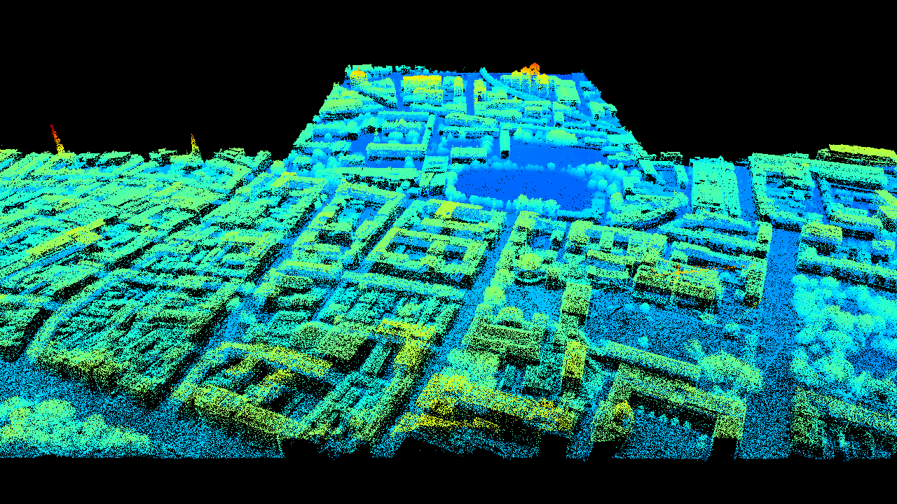

# Dublin City Aerial LiDAR

Aerial LiDAR of central Dublin: a city block at full density and the 1 km² area around it, ready to label buildings, roofs, ground and vegetation.

## Overview

This sample project contains two point clouds cut from four 500 × 500 m tiles of the 2015 aerial laser scan of Dublin city centre (384,678,938 points in the four tiles):

- `dublin_city_block_80m.pcd`: an 80 × 80 m crop at full density (about 465 points per m²), 2,978,224 points: a row of street trees, a street with parked cars and the roofs and facades of the buildings beside it;
- `dublin_4_tiles_overview.pcd`: the whole 1 km² area of the four tiles, randomly thinned to 2,893,956 points (1 in 133), to show how small the block is within it.

Each point has `x`, `y`, `z` and `intensity`. The project has four classes with the **Point Cloud** shape (`building`, `roof`, `ground`, `vegetation`) and no labels.

Use it to:

- label city-scale aerial LiDAR, each building, roof or tree kept as one point-level object;
- try the Point Cloud Pen, the Top, Side and Front views and the Area of Interest on dense urban data.

## How to Use This Project

1. Click **Get project** in the Supervisely Ecosystem.
2. Open the `ds0` dataset in the 3D Point Cloud Editor.
3. Open `dublin_city_block_80m.pcd`, choose a class and label a roof, a building and a tree with the Point Cloud Pen.
4. To work with all 384.7 million points as one streamed octree cloud, download the four tiles from the NYU Spatial Data Repository (link below), put their LAZ files in one folder in Team Files and import the folder with **Auto Import**: a cloud of more than 10 million points is imported as a streamed octree, and the tiles of one scene are merged into one cloud.

See the complete workflow in [Annotate Massive Point Clouds](https://docs.supervisely.com/use-cases/massive-point-cloud-octree-annotation).

## Download

Download the project in Supervisely format: [project.zip](https://github.com/supervisely-ecosystem/dublin-city-aerial-lidar-octree/releases/download/v1.0.0/project.zip).

## Dataset Source and License

The point clouds come from **Aerial Laser and Photogrammetry Survey of Dublin City, 2015** by Debra F. Laefer, Saleh Abuwarda, Anh-Vu Vo, Linh Truong-Hong and Hamid Gharibi, published by New York University, Center for Urban Science and Progress, in the NYU Spatial Data Repository: [record](https://ultraviolet.library.nyu.edu/records/aqjnq-6c976), DOI [10.17609/n8mq0n](https://doi.org/10.17609/n8mq0n). Tiles used: `T_315500_233500`, `T_316000_233500`, `T_316000_234000` and `T_316500_233500` (aerial laser scanning, LAZ).

They are used under the [Creative Commons Attribution 4.0 International (CC BY 4.0)](https://creativecommons.org/licenses/by/4.0/) license, as stated on the record.

Citation:

> Laefer, D. F., Abuwarda, S., Vo, A.-V., Truong-Hong, L., Gharibi, H. (2017). Aerial Laser and Photogrammetry Survey of Dublin City, 2015. New York University, Center for Urban Science and Progress. NYU Spatial Data Repository. https://doi.org/10.17609/n8mq0n

Changes:

- Converted from LAZ 1.2 to binary PCD with the fields `x`, `y`, `z` and `intensity`; the other attributes (returns, classification, scan angle, GPS time and others) were dropped.
- `dublin_city_block_80m.pcd`: points within E 316,275–316,355 and N 233,815–233,895 (TM65 / Irish Grid), all kept.
- `dublin_4_tiles_overview.pcd`: a random 1-in-133 subsample of the four tiles.
- Isolated noise points below −20 m or above 120 m were removed from both files.
- Both files are shifted by E −316,250 m and N −234,000 m (TM65 / Irish Grid) to keep float precision; heights are unchanged. Add the offset back to get the original coordinates.
- Four empty classes were added; there are no annotations.
